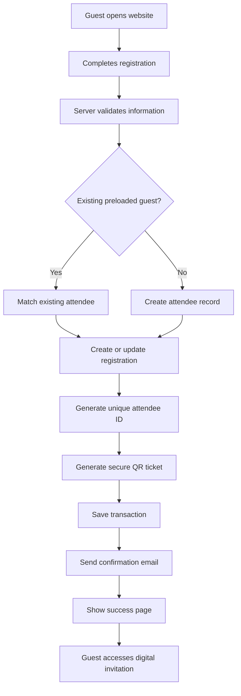
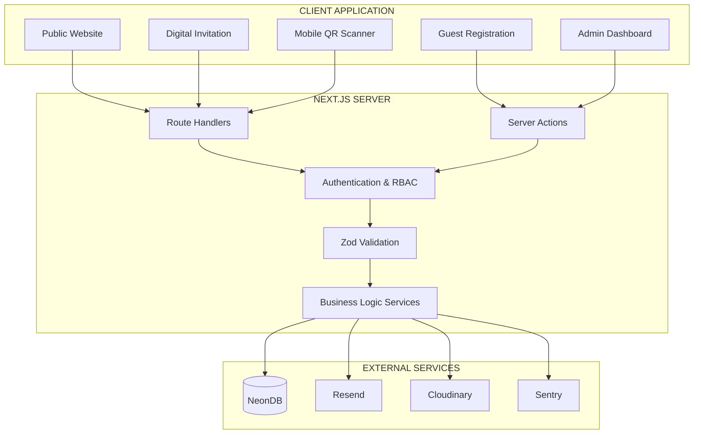

# DELOUS '26 — Final Implementation-Ready PRD

Requirements confirmed Ready for development handoff

Product: DELOUS '26 Wedding Experience & Guest Management Platform Couple: Olasubulumi Adesola & Dare Samuel Event: Saturday, 28 November 2026 Technology: Next.js, TypeScript, NeonDB, Drizzle ORM

The clarification answers are now incorporated into the product specification. The product direction is locked around an open-registration model, controlled guest management, individual digital invitations and a single-entry QR check-in system.

The most important architectural decision is that anyone can submit a registration, but every registration remains an individual attendee record. Administrators can also preload approved guests, manage invitation groups and monitor registration without allowing group representatives to create uncontrolled guest lists.

## 1. Confirmed product decisions

| Requirement | Final decision |
| --- | --- |
| Registration access | Open public registration |
| Expected attendance | 500–1,000 guests |
| Guest preloading | CSV upload and public registration |
| Group management | Administrators only |
| Check-in venues | One unified check-in system |
| Background music | Optional, guest-controlled |
| Initial gallery | Pre-wedding photographs |
| Language | English with Yoruba expressions |
| Domain | Existing domain to be connected |
| Admission | One registered person per invitation |
| QR ticket | Unique per attendee |

## 2. Product scope and operating rules

The platform has three distinct operating areas:

1. Public wedding experience.
2. Guest registration and digital invitation.
3. Private administration and event check-in.

### Registration policy

- Public registration is open to everyone.
- Preloaded guests can also register through the website.
- Preloaded guests should be matched against their existing records where possible.
- Administrators can manually add guests.
- Administrators alone can create, modify and assign invitation groups.
- One individual registration generates one individual ticket.
- A registration is not permission to bring additional participants.
- Guests cannot create or manage groups.
- Registration does not automatically mean the guest has physically attended.

### Guest admission policy

Every guest must have:

- A unique attendee record.
- A valid registration.
- A unique, active QR ticket.
- A successful identity verification at the entrance.

One QR ticket permits one person only.

The single check-in system will record the attendee's admission once, regardless of whether they later attend the church ceremony, reception or both.

## 3. Public wedding experience

### 3.1 Website design identity

The visual direction is a luxurious fusion of Yoruba royalty, contemporary Nigerian wedding culture and high-fashion editorial design.

Ondo Alaari Asooke inspiration for Yoruba weddings. | Traditional wedding attire, Yoruba wedding, Wedding attire

Luxury Event Design & Decor | KAS Inspirations | TX

Nigerian Wedding Fashion: Complete Guide to Traditional Attire for Guests | Àròkò Designs

Design system

| Design token | Specification |
| --- | --- |
| Royal burgundy | `#541323` |
| Deep wine | `#260811` |
| Antique gold | `#C6A15B` |
| Champagne | `#F2E7D4` |
| Warm ivory | `#FAF6EF` |
| Rich black | `#171313` |
| Primary heading | Cormorant Garamond |
| Secondary heading |  |
| Body | Inter |

These are proposed brand tokens and can be adjusted during design.

### 3.2 Homepage experience

The homepage should follow this sequence:

1. Cinematic opening animation.
2. DELOUS '26 identity reveal.
3. Couple's names and wedding announcement.
4. Hero photograph.
5. Wedding countdown.
6. Couple's story.
7. Wedding programme.
8. Dress code.
9. Registration invitation.
10. Pre-wedding gallery.
11. FAQs.
12. Footer and contact information.

The opening experience should have an optional skip button so returning visitors do not have to watch the full animation.

Proposed hero copy:

> THE UNION OF TWO FAMILIES. THE CELEBRATION OF A LIFETIME.
>
> OLASUBULUMI ADESOLA & DARE SAMUEL
>
> DELOUS '26 28 NOVEMBER 2026
>
> A royal celebration of love, culture and legacy.

### 3.3 Yoruba cultural identity

The website should integrate Yoruba expressions naturally rather than becoming a translation-heavy website.

Suggested phrases:

- Ẹ káàbọ̀ — Welcome.
- Ìfẹ́ ni gbogbo rẹ̀ — Love is everything.
- Ayọ̀ àti ìbùkún — Joy and blessings.
- Ìdùnnú pọ̀\! — Let there be great celebration.

These expressions should appear in selected sections, loading experiences, decorative elements and celebratory messages.

A language toggle is not required for the initial release. English remains the primary language.

### 3.4 Animation requirements

Use Motion (Framer Motion) for:

- Page entrance and exit transitions.
- Hero text reveals.
- Countdown number transitions.
- Scroll-triggered reveals.
- Gallery transitions.
- Animated registration confirmation.
- QR invitation reveal.
- Navigation interactions.

Use CSS for simple ambient effects, such as shimmer, floating ornaments and subtle gold gradients.

Avoid excessive animation on forms and administrative screens.

### 3.5 Music requirements

Music is optional and can autoplay without an explicit visitor action.
Scaffold the template now, I will provide the music file later.
The music player should include:

- Play/pause.
- Mute/unmute.
- Volume control.
- Mobile-friendly controls.
- Persistent preference while navigating the website.

The audio asset must be licensed or supplied by the wedding organisers.

## 4. Wedding information and content

The following details are the authoritative event information for the initial release.

# DELOUS '26

## The Wedding Celebration

Saturday, 28 November 2026

10:00 AM WAT

Wedding ceremony

Araromi Baptist Church

42, Shokunbi Street, Mushin, Lagos State.

Reception

ECWA Event Hall, Challenge, Mushin.

Colour of the day

## White & Ofi

RSVP / Enquiries

- Daniel: 09036902177
- Peluola: 09020602232

The admin dashboard should allow the organisers to update event information without redeploying the application.

## 5. Registration and attendee lifecycle

Core business logic### 5.1 Registration form specification

| Field | Input | Validation |
| --- | --- | --- |
| Full name | Text | Required |
| Email | Email | Required, valid format |
| Phone | Telephone | Required, valid format |
| Relationship with couple | Select | Required |
| Who invited you? | Text | Required |
| Attendance certainty | Select | Required |
| Privacy consent | Checkbox | Required |

Relationship options:

- Bride's family.
- Groom's family.
- Bride's friend.
- Groom's friend.
- Family friend.
- Colleague.
- Church member.
- Other.

Attendance certainty:

- Definitely attending.
- Most likely attending.
- Not sure yet.
- Unable to attend.

The form should include a prominent admission notice:

> This invitation is strictly for one registered person. Bringing unregistered participants is not permitted. Every attendee must register individually and receive their own digital invitation.

### 5.2 Preloaded guest matching

Administrators can upload a CSV containing:

- Full name.
- Email, if available.
- Phone number, if available.
- Invitation group.
- Inviter.
- Optional internal notes.

The import process should:

1. Validate the CSV headers.
2. Preview the records.
3. Detect duplicates.
4. Identify incomplete records.
5. Allow administrators to correct errors.
6. Import valid records.
7. Generate an import summary.

Preloaded guests should have a `preloaded` record status.

When they register publicly, the system should match them against their existing record using verified identifiers.

Matching priority:

1. Exact verified email match.
2. Normalised phone number match.
3. Manual administrator review where matching is ambiguous.

Do not automatically merge two people just because their names are similar.

An existing preloaded guest who registers should update their existing attendee record rather than create another attendee and another ticket.

### 5.3 Registration states

The system should distinguish between registration, attendance intention and actual attendance.

| Registration status | Meaning |
| --- | --- |
| Preloaded | Imported guest who has not completed registration |
| Registered | Guest has submitted registration |
| Confirmed | Registration has been accepted |
| Revoked | Guest's admission credentials have been deactivated |

Attendance certainty is stored separately:

| Attendance response | Meaning |
| --- | --- |
| Definitely attending | Positive confirmation |
| Most likely attending | Probable |
| Not sure yet | Undecided |
| Unable to attend | Declined |

Physical attendance is stored independently as:

- Not checked in.
- Checked in.

A guest who selects "Unable to attend" should not be automatically deleted or prevented from updating their response later.

### 5.4 Registration workflow

mermaid



Registration, ticket creation and attendee updates should be performed in a database transaction.

Email delivery should happen after the transaction commits.

If email delivery fails, the registration remains valid and the email is queued for retry.

## 6. Digital ticket and email specification

### 6.1 Ticket design

Undangan Digital | Amerta Invitation

[amertainvitation.com](<https://amertainvitation.com/?utm_source=chatgpt.com>)

The digital ticket should display:

- DELOUS '26.
- Guest's full name.
- Attendee ID.
- Wedding date.
- Ceremony and reception information.
- Dress code.
- QR code.
- Single-person admission disclaimer.

Example attendee ID:

`DELOUS-26-000001`

The ID should be sequential-looking for administrative convenience, but must never be used as the security credential.

The actual QR token must be randomly generated and unguessable.

### 6.2 Email implementation

Use Resend for transactional email.

Recommended email templates:

1. Registration confirmation.
2. Digital invitation.
3. Invitation resend.
4. Registration update.
5. Seven-day reminder.
6. Three-day reminder.
7. One-day reminder.
8. Post-wedding appreciation.

Every email should have a consistent DELOUS visual identity.

Email delivery should be tracked using:

- Pending.
- Sent.
- Delivered, where provider events are available.
- Failed.
- Bounced.

The system should avoid repeatedly sending identical emails if a request is retried.

### 6.3 Ticket recovery

A guest who loses their email should be able to request a replacement invitation through a secure retrieval flow.

Suggested process:

1. Guest submits their registered email or phone.
2. System sends a one-time verification code.
3. Guest verifies ownership.
4. System provides a secure invitation access link.
5. Guest views or downloads their invitation.

Never reveal whether an email address or phone number exists in the database through public error messages.

## 7. Gallery and FAQ specifications

### Gallery

Initial release supports pre-wedding images only.

Requirements:

- Responsive masonry layout.
- Full-screen lightbox.
- Image navigation.
- Swipe on mobile.
- Lazy loading.
- Image optimisation.
- Alt text.
- Admin-controlled ordering.
- Draft and published states.

The backend should be designed to support wedding-day photos and videos in a future release.

### FAQ management

Administrators should be able to:

- Create FAQs.
- Edit answers.
- Delete FAQs.
- Reorder questions.
- Publish or hide questions.

The public page should use accessible accordion components.

# 8. Admin dashboard — final specification

## 8.1 Navigation structure

DELOUS '26 ADMIN

Private

Overview

Guests

Invitation Groups

Registrations

Digital Tickets

Check-in

Gallery

FAQs

Email Campaigns

Reports

Staff & Permissions

Settings

## 8.2 Dashboard analytics

The dashboard must display:

- Total preloaded guests.
- Total registered guests.
- Total confirmed registrations.
- Attendance certainty breakdown.
- Registration conversion rate.
- Total checked-in guests.
- Outstanding check-ins.
- Registration trends.
- Guest distribution by group.

Suggested calculations:

$$
\text{Registration Rate} =
\frac{\text{Registered Preloaded Guests}}
{\text{Total Preloaded Guests}}\times100
$$

$$
\text{Check-in Rate} =
\frac{\text{Checked-in Guests}}
{\text{Eligible Registered Guests}}\times100
$$

Public registrations should be reported separately from preloaded-list conversion so that the numbers remain meaningful.

## 8.3 Invitation groups

Only administrators can create, edit and delete groups.

Each group contains:

- Name.
- Description.
- Group representative.
- Contact details.
- Assigned attendees.
- Registration count.
- Check-in count.
- Status.

Suggested initial groups:

- Bride's Family.
- Groom's Family.
- Bride's Friends.
- Groom's Friends.
- Family Friends.
- Church Community.
- Special Guests.

Groups are organisational tools, not shared invitations.

## 8.4 Guest management

The guest management table should support:

- Search by name.
- Search by attendee ID.
- Search by phone/email.
- Filter by group.
- Filter by registration status.
- Filter by attendance certainty.
- Filter by check-in status.
- Sort by registration date.
- CSV export.

Administrators should have actions to:

- View guest profile.
- Edit guest details.
- Assign invitation group.
- Update attendance certainty.
- Resend invitation.
- Deactivate ticket.
- Reactivate a valid registration.
- Manually register a guest.
- View guest activity history.

Destructive actions should require confirmation.

## 8.5 QR check-in

There will be one unified entrance check-in operation.

InVyt — Simplify Your Event Invitations &amp; Check-Ins

[invyt.ng](<https://www.invyt.ng/?utm_source=chatgpt.com>)

The check-in interface should be designed primarily for mobile phones and tablets.

Scanning sequence:

1. Officer logs in.
2. Opens check-in.
3. Starts camera scanner.
4. Guest presents QR code.
5. System verifies ticket.
6. Guest details appear.
7. Officer verifies the person's name.
8. Officer confirms admission.
9. System records the check-in.
10. Success screen appears.

The scanner must handle:

- Valid ticket.
- Already checked-in ticket.
- Revoked ticket.
- Invalid ticket.
- Expired or otherwise unusable credential.
- Camera permission failure.
- Network failure.

The system should not automatically admit a guest just because a QR code can be read. The server must validate the ticket and record a successful admission.

Operational recommendation: Have a separate manual-search station available in case a guest has a damaged phone, lost email or unreadable QR code.

## 8.6 Admin roles

| Permission | Super Admin | Wedding Admin | Check-in Officer | Content Manager |
| --- | --- | --- | --- | --- |
| Dashboard | Yes | Yes | Limited | Limited |
| Manage guests | Yes | Yes | No | No |
| Manage groups | Yes | Yes | No | No |
| Import CSV | Yes | Yes | No | No |
| Check-in | Yes | Yes | Yes | No |
| Export records | Yes | Yes | No | No |
| Manage gallery | Yes | No | No | Yes |
| Manage FAQs | Yes | No | No | Yes |
| Manage staff | Yes | No | No | No |
| Change settings | Yes | Limited | No | No |

The permissions should be enforced server-side, not simply hidden in the interface.

# 9. Technical implementation specification

## 9.1 Final technology stack

The following stack is approved for implementation.

| Layer | Technology | Responsibility |
| --- | --- | --- |
| Framework | Next.js App Router | Application framework |
| Language | TypeScript | Type safety |
| Styling | Tailwind CSS | Design system |
| Components | shadcn/ui | Reusable UI |
| Animation | Motion | Cinematic interactions |
| Database | NeonDB | PostgreSQL storage |
| ORM | Drizzle ORM | Database access and migrations |
| Authentication | Auth.js | Admin authentication |
| Validation | Zod | Input and server validation |
| Forms | React Hook Form | Registration and admin forms |
| Email | Resend | Transactional emails |
| QR generation | qrcode | Ticket QR generation |
| QR scanning | html5-qrcode | Entrance scanning |
| File storage | Cloudinary | Pre-wedding images |
| Charts | Recharts | Admin analytics |
| Deployment | Vercel | Hosting |
| Monitoring | Sentry | Application errors |

### 9.2 Application architecture

mermaid



### 9.3 Recommended project structure

text

```text
delous-26/
├── public/
│   ├── images/
│   ├── fonts/
│   ├── audio/
│   └── branding/
│
├── src/
│   ├── app/
│   │   ├── (public)/
│   │   │   ├── page.tsx
│   │   │   ├── our-story/
│   │   │   ├── the-wedding/
│   │   │   ├── register/
│   │   │   ├── invitation/
│   │   │   ├── gallery/
│   │   │   └── faqs/
│   │   │
│   │   ├── (auth)/
│   │   │   └── admin/login/
│   │   │
│   │   ├── admin/
│   │   │   ├── dashboard/
│   │   │   ├── guests/
│   │   │   ├── groups/
│   │   │   ├── registrations/
│   │   │   ├── tickets/
│   │   │   ├── check-ins/
│   │   │   ├── gallery/
│   │   │   ├── faqs/
│   │   │   ├── emails/
│   │   │   ├── reports/
│   │   │   └── settings/
│   │   │
│   │   └── api/
│   │       ├── register/
│   │       ├── tickets/
│   │       ├── check-in/
│   │       ├── guests/
│   │       ├── imports/
│   │       └── webhooks/
│   │
│   ├── components/
│   │   ├── ui/
│   │   ├── public/
│   │   ├── admin/
│   │   ├── registration/
│   │   ├── invitation/
│   │   └── check-in/
│   │
│   ├── lib/
│   │   ├── auth/
│   │   ├── db/
│   │   ├── email/
│   │   ├── qr/
│   │   ├── validation/
│   │   ├── permissions/
│   │   └── utils/
│   │
│   ├── services/
│   │   ├── registration.service.ts
│   │   ├── guest.service.ts
│   │   ├── ticket.service.ts
│   │   ├── checkin.service.ts
│   │   ├── email.service.ts
│   │   └── analytics.service.ts
│   │
│   └── db/
│       ├── schema/
│       ├── migrations/
│       └── seed.ts
│
├── drizzle.config.ts
├── next.config.ts
├── package.json
└── .env.example
```

This structure separates the user interface, business logic and database operations so that the application remains maintainable.

## 10. NeonDB database specification

The database must support 500–1,000 expected guests, public registrations, preloaded attendees, ticket issuance and reliable check-ins.

### 10.1 Core schema

| Table | Important fields |
| --- | --- |
| users | id, name, email, password/auth reference, status |
| roles | id, name |
| user\_roles | user\_id, role\_id |
| invitation\_groups | id, name, description, status |
| guests | id, attendee\_code, name, email, phone, group\_id, source |
| registrations | id, guest\_id, relationship, invited\_by, attendance\_response, status |
| tickets | id, guest\_id, token\_hash, status, issued\_at, revoked\_at |
| check\_ins | id, ticket\_id, officer\_id, checked\_in\_at |
| email\_logs | id, guest\_id, template, status, provider\_id |
| gallery | id, image\_url, caption, sort\_order, status |
| faqs | id, question, answer, sort\_order, status |
| audit\_logs | id, user\_id, action, entity\_type, entity\_id, created\_at |
| wedding\_settings | id, setting\_key, setting\_value |

### 10.2 Important schema rules

- Every attendee must have a unique `attendee_code`.
- Every guest can have only one active registration.
- Every active registration has one active ticket.
- Every ticket has a unique token hash.
- Every check-in references an existing ticket.
- Each ticket can have only one successful check-in.
- Group deletion must not delete associated guests.
- Guest deactivation must not erase historical attendance records.
- Administrative actions must be auditable.

Recommended database indexes:

- `guests.attendee_code`
- `guests.email`
- `guests.phone`
- `guests.group_id`
- `registrations.status`
- `registrations.attendance_response`
- `tickets.token_hash`
- `check_ins.checked_in_at`

Use case-insensitive email uniqueness for registrations where appropriate, but do not make phone or email uniqueness an unconditional constraint on all guest records. Some family members may share contact information. Resolve duplicate identity through registration matching and administrator review.

### 10.3 Atomic check-in logic

A ticket must not be admitted twice, even if two officers scan it simultaneously.

Implement a transaction that:

1. Finds the active ticket by token hash.
2. Verifies its status.
3. Checks whether a successful check-in already exists.
4. Inserts the check-in record.
5. Commits the transaction.
6. Returns the admission result.

A database unique constraint on successful ticket check-ins should provide an additional safeguard.

### 10.4 Email reliability

Implement a transactional outbox table or equivalent durable email queue.

This ensures that:

- Registrations are not lost when Resend is unavailable.
- Emails can be retried.
- Duplicate messages are avoided through idempotency keys.
- Delivery events can be tracked.
- Failed email operations can be reviewed by administrators.

## 11. API specification

The application should expose documented server-side operations.

| Endpoint | Method | Purpose |
| --- | --- | --- |
| `/api/register` | POST | Public registration |
| `/api/guests` | GET | List guests |
| `/api/guests` | POST | Create guest |
| `/api/guests/[id]` | PATCH | Update guest |
| `/api/imports/guests` | POST | Import CSV |
| `/api/tickets/[token]` | GET | Verify ticket access |
| `/api/tickets/resend` | POST | Resend invitation |
| `/api/check-in/scan` | POST | Validate and check in |
| `/api/check-in/search` | GET | Search attendees |
| `/api/check-in/history` | GET | Check-in history |
| `/api/groups` | GET/POST | Manage groups |
| `/api/faqs` | GET/POST | Manage FAQs |
| `/api/gallery` | GET/POST | Manage gallery |
| `/api/webhooks/resend` | POST | Receive email events |

All admin endpoints require authentication and appropriate role permissions.

Public registration endpoints require rate limiting, server-side validation and abuse protection.

# 12. UX and interface specifications

## 12.1 Mobile-first requirements

Most guests will likely access the invitation using WhatsApp or email on their phones.

Therefore:

- Registration must be easy on mobile.
- QR tickets must fit comfortably on mobile screens.
- Gallery navigation must support touch.
- The website must load without requiring a desktop.
- Buttons must be sufficiently large.
- Text must remain readable.
- The registration process should not require account creation.

## 12.2 Admin usability

The administration interface should prioritise operational speed over decorative effects.

Recommended features:

- Persistent sidebar on desktop.
- Collapsible mobile navigation.
- Searchable data tables.
- Pagination.
- Bulk guest operations.
- CSV import preview.
- Clear confirmation dialogs.
- Real-time check-in feedback.
- Downloadable reports.

## 12.3 Design system components

Build reusable components for:

- Buttons.
- Inputs.
- Select menus.
- Registration fields.
- Modals.
- Accordions.
- Data tables.
- Status badges.
- Statistic cards.
- QR ticket cards.
- Toast notifications.
- Gallery lightboxes.
- Loading skeletons.
- Empty states.
- Error states.

The public website should be visually expressive; the dashboard should be clean, efficient and professional.

# 13. Security and operational requirements

| Area | Implementation requirement |
| --- | --- |
| Authentication | Secure admin sessions |
| Permissions | Server-enforced RBAC |
| QR security | Random opaque tokens, hashed at rest |
| Registration | Rate limits and anti-abuse controls |
| Data protection | HTTPS and restricted access |
| Database | Neon backups and recovery plan |
| Audit | Log sensitive administrative changes |
| Uploads | Validate file types and sizes |
| Email | Signed webhook verification |
| Ticket retrieval | OTP-based verification |
| Check-in | Atomic admission transaction |
| Privacy | Data collection and retention policy |

### Important operational detail: Internet connectivity

The check-in system should assume a working internet connection because ticket validation must happen against the central database.

Provide:

- Multiple mobile scanning devices.
- A dedicated hotspot or reliable event internet.
- Backup power banks.
- A manual guest lookup interface.
- A printed, access-controlled emergency guest list.

Do not implement offline admission by simply accepting QR codes locally. That could allow the same ticket to be used at multiple disconnected entrances.

# 14. Non-functional and performance requirements

| Metric | Target |
| --- | --- |
| Guest capacity | 500–1,000 expected attendees |
| Public page loading | Good Core Web Vitals |
| LCP | Under 2.5 seconds target |
| Registration | Idempotent and transaction-safe |
| Check-in response | Under 2 seconds target under normal network conditions |
| Admin usability | Responsive on tablet and desktop |
| Availability | Reliable during wedding-day operations |
| Accessibility | Keyboard and reduced-motion support |
| Image delivery | Optimised and responsive |
| Monitoring | Error reporting and service monitoring |

Load testing should simulate bursts of registration and simultaneous check-in requests rather than testing only the expected total guest count.

# 15. Final acceptance and launch checklist

The project is not complete simply because the homepage looks beautiful.

The following must all pass before launch.

## Public experience

- [ ]Landing page matches approved visual direction.
- [ ]Countdown works in Lagos time.
- [ ]Wedding details are accurate.
- [ ]Yoruba expressions display correctly.
- [ ]Music requires user interaction.
- [ ]Gallery works on mobile and desktop.
- [ ]FAQs are functional.
- [ ]Registration is publicly accessible.
  ## Registration and tickets
- [ ]Every registration creates an individual attendee record.
- [ ]Preloaded guests can be matched correctly.
- [ ]Duplicate registrations are handled safely.
- [ ]Every successful registration generates a unique ID.
- [ ]Each guest receives an individual QR ticket.
- [ ]Email failures do not destroy registrations.
- [ ]Invitation retrieval works securely.
- [ ]One-person admission disclaimer is visible.
  ## Administration
- [ ]Admin can create and manage groups.
- [ ]Admin can import CSV records.
- [ ]Admin can search and filter guests.
- [ ]Admin can update guest responses.
- [ ]Admin can resend invitations.
- [ ]Dashboard statistics are accurate.
- [ ]Admin permissions are enforced.
- [ ]Sensitive actions are audited.
  ## Check-in
- [ ]QR scanner works on supported mobile devices.
- [ ]Valid tickets are admitted.
- [ ]Duplicate tickets are rejected.
- [ ]Revoked tickets are rejected.
- [ ]Manual lookup works.
- [ ]Check-in records include officer and timestamp.
- [ ]Simultaneous scans cannot admit the same guest twice.
  ## Production readiness
- [ ]Domain and HTTPS configured.
- [ ]Database migrations completed.
- [ ]Production environment variables secured.
- [ ]Email domain verified.
- [ ]Backup and recovery process tested.
- [ ]Error monitoring enabled.
- [ ]Load and security testing completed.
- [ ]Wedding-day check-in rehearsal completed.


# DELOUS '26

## Love. Legacy. Culture. Celebration.

One wedding. One extraordinary digital experience.

The finished product will combine:

- An extravagant Nigerian wedding experience.
- A premium digital invitation.
- An open individual registration platform.
- A structured guest-management system.
- A secure QR admission system.
- A central administrative dashboard.
- A culturally expressive, animated visual identity.

Expected guest capacity

500–1,000

Admission model

One person, one ticket

Check-in model

Single entrance system

Technology

Next.js + NeonDB

Target event

28 November 2026

DELOUS '26 should look like a royal celebration and operate like a professionally managed event.